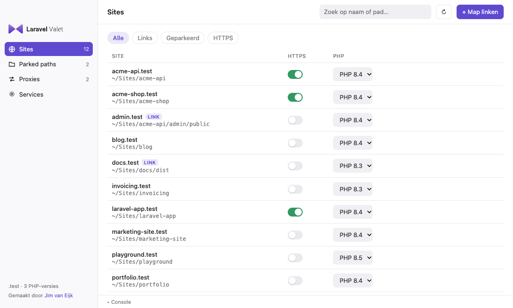
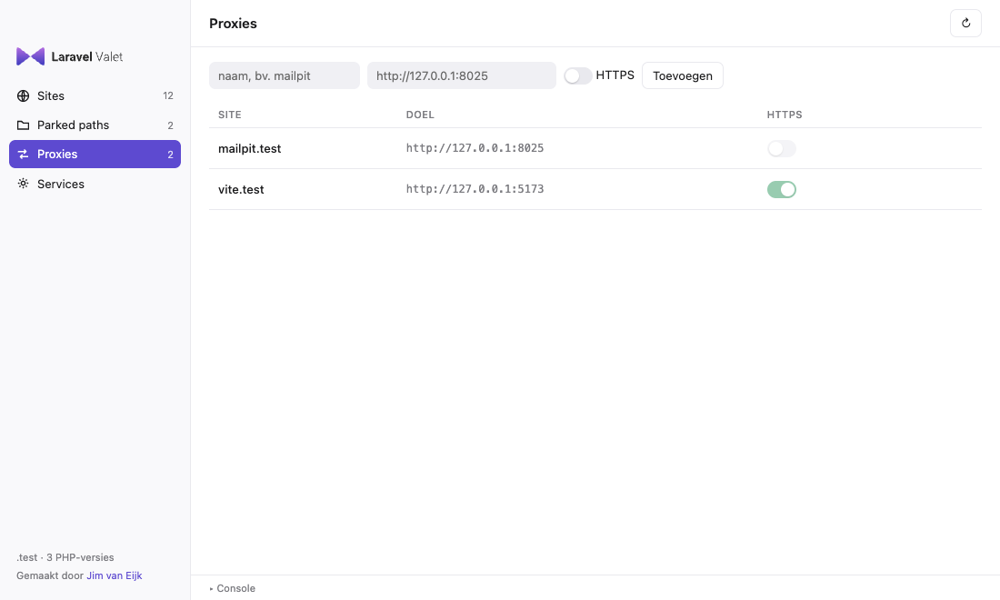
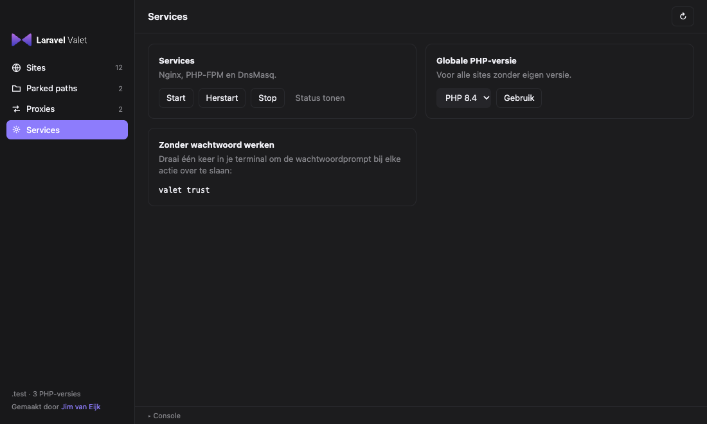

<p align="center"></p>

# Valet GUI

A small macOS desktop app for [Laravel Valet](https://laravel.com/docs/valet), so you don't need the terminal for everyday tasks.

<picture>
  <source media="(prefers-color-scheme: dark)" srcset="docs/sites-dark.png">
  
</picture>

<p>
  
  
</p>

- See all parked and linked sites, search and filter them
- Toggle HTTPS per site, pick a PHP version per site (`isolate`)
- Link and park folders with a folder picker, forget parked paths
- Add and remove proxies
- Start, restart and stop services, set the global PHP version

Made by [Jim van Eijk](https://github.com/jimvaneijk). Not affiliated with Laravel; the Valet logo belongs to Laravel.

## Install

Download the `.dmg` for your Mac (Apple Silicon `arm64` or Intel `x64`) from [Releases](https://github.com/jimvaneijk/laravel-valet-gui/releases/latest).

Requires Valet to be installed already (`valet` and `php` on your `PATH`).

Unsigned builds are blocked by Gatekeeper ("app is damaged"). Remove the quarantine flag once after moving it to Applications:

```bash
xattr -cr "/Applications/Valet GUI.app"
```

## Passwords

Valet runs every command through `sudo`. Reading your sites doesn't need it; changes show the macOS admin prompt. Run `valet trust` once to skip that prompt.

## Development

```bash
npm install
npm start
```

## Releasing

Push a version tag; GitHub Actions builds the app and publishes a GitHub Release:

```bash
git tag v0.2.0 && git push origin v0.2.0
```

The app checks Releases on launch. Signed builds update themselves; unsigned builds show a download link in the sidebar. To sign and notarize, add the repo secrets `CSC_LINK`, `CSC_KEY_PASSWORD`, `APPLE_ID`, `APPLE_APP_SPECIFIC_PASSWORD` and `APPLE_TEAM_ID`.

## License

MIT
